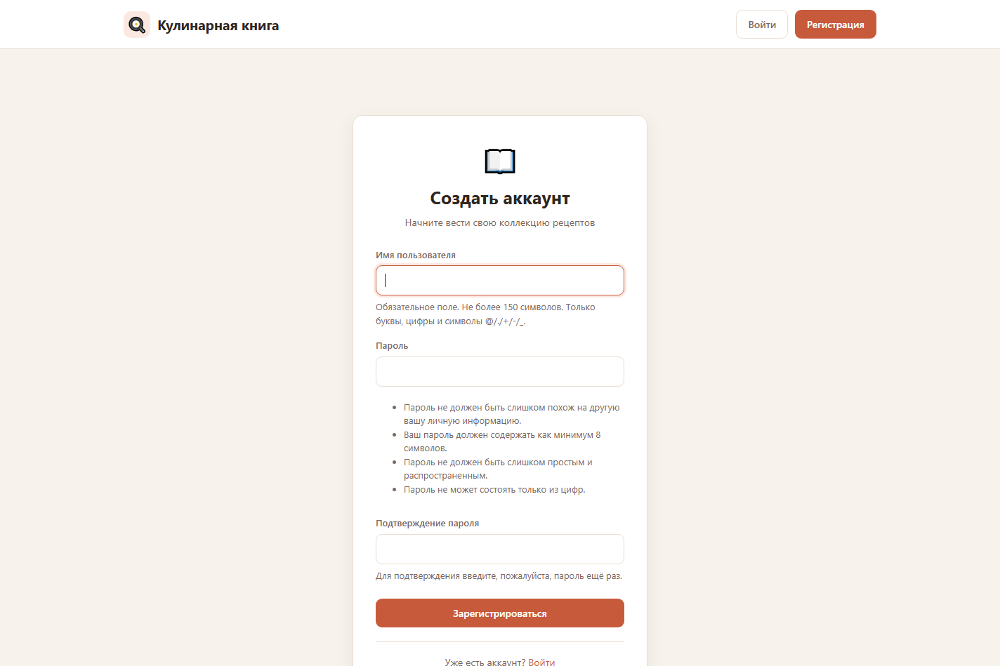
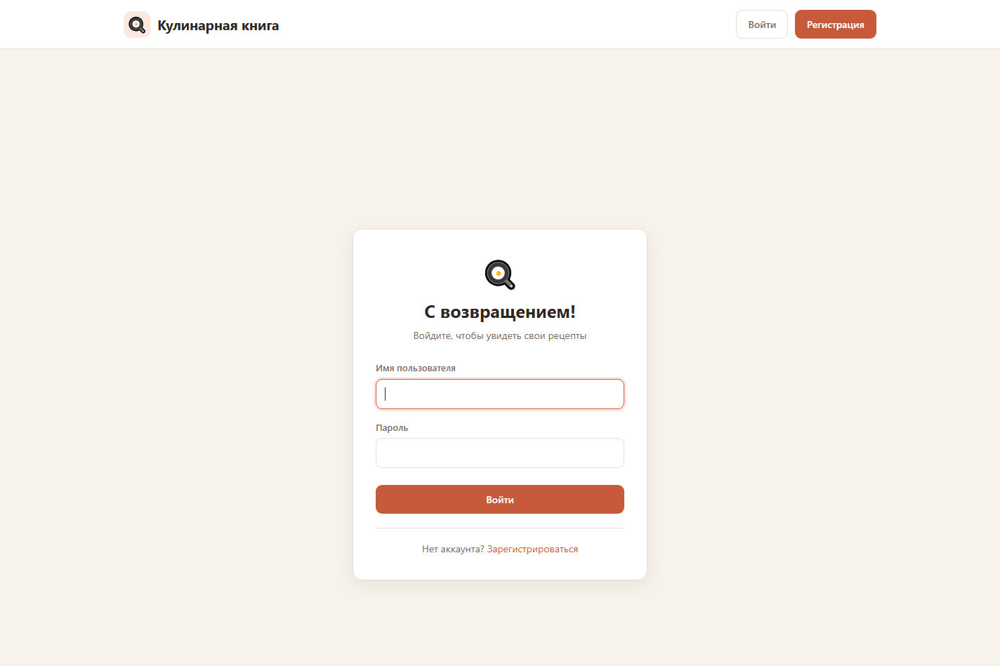
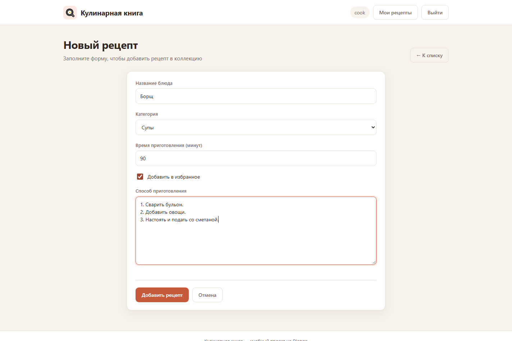
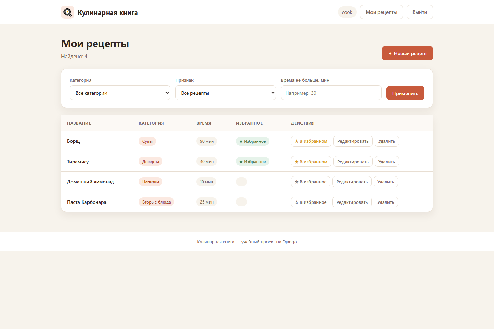
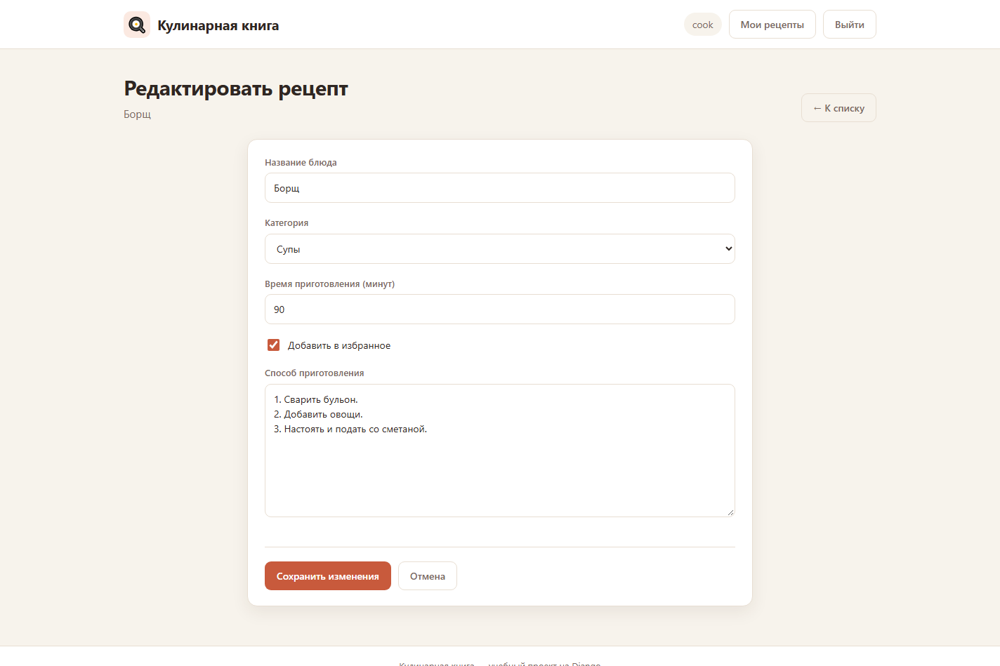
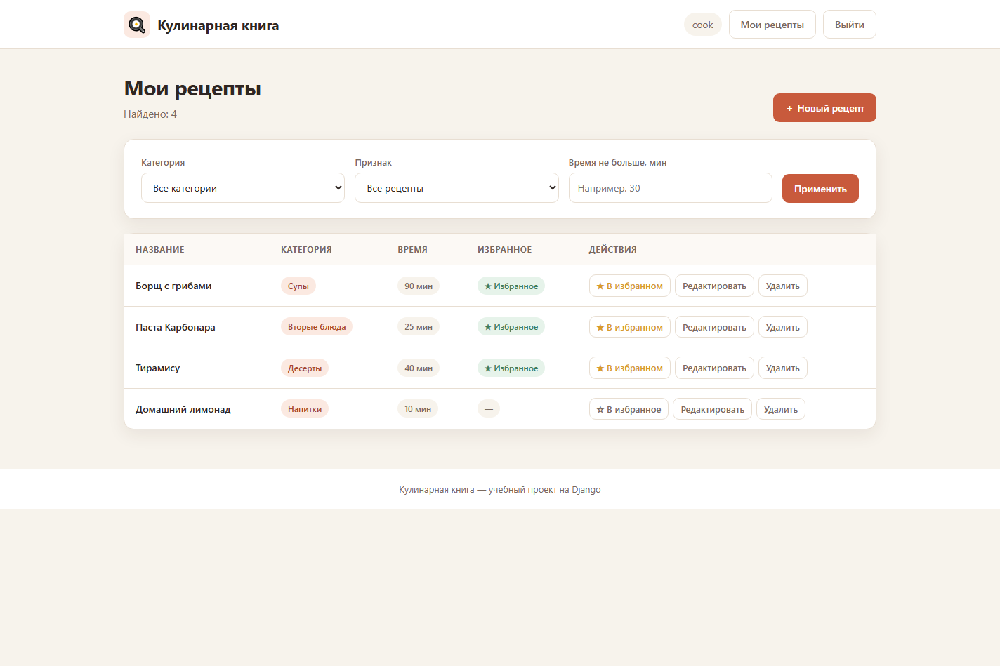
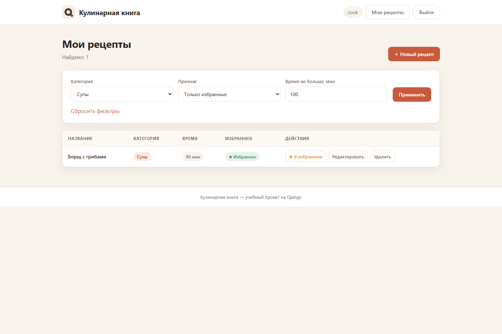
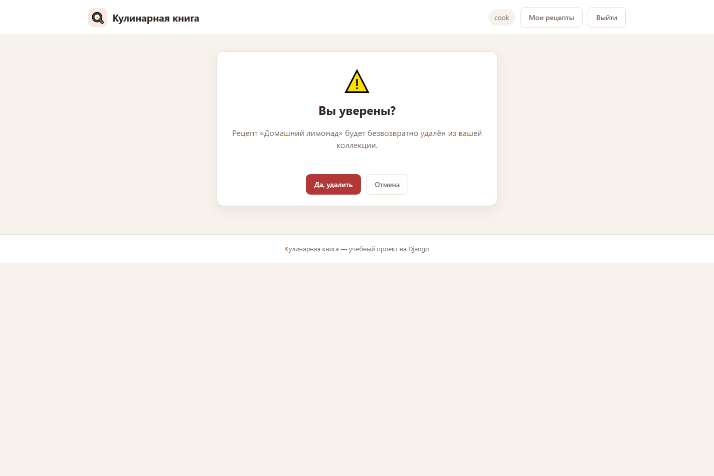

# Лабораторная работа

## Веб-приложение «Кулинарная книга» на Django

**Цель:** закрепить навыки создания веб-приложения на Django с авторизацией
пользователей и выполнением CRUD-операций.

---

## 1. Дизайн проекта в Figma

Работа над проектом началась с проектирования интерфейса в Figma. Были
разработаны экраны для всех пользовательских сценариев: вход, регистрация,
список рецептов с фильтрами, форма рецепта и подтверждение удаления.

### Концепция интерфейса

- **Цветовая палитра:** тёплый бежевый фон (`#F7F3EC`), белые карточки,
  терракотовый акцент (`#C85A3C`) для основных кнопок, зелёный для избранного,
  мягкие серые границы.
- **Типографика:** системный без-serif (`Segoe UI`), заголовки выделены
  размером и полужирным начертанием.
- **Компоненты:** шапка с меню и кнопкой выхода, карточки, таблица рецептов,
  бейджи категории/времени/избранного, кнопки действий, форма фильтров,
  центрированная карточка авторизации.

### Список экранов

| № | Экран | Назначение |
| --- | --- | --- |
| 1 | Вход | Форма логина и пароля, ссылка на регистрацию |
| 2 | Регистрация | Логин, пароль, подтверждение пароля |
| 3 | Мои рецепты | Список рецептов, фильтры, кнопки действий |
| 4 | Новый/редактирование рецепта | Форма полей модели |
| 5 | Подтверждение удаления | Диалог «Вы уверены?» |

**Ссылка на макет в Figma:** _[вставить ссылку]_

**Скриншоты макетов:**


---

## 2. Исходный код проекта

Проект создан стандартным способом: `django-admin startproject cookbook`,
затем `django-admin startapp recipes`. Данные хранятся в SQLite (`db.sqlite3`),
формы построены на `forms.ModelForm`, шаблоны используют базовый `base.html`
с блоком ``.

### Структура проекта

```
cookbook/
├── manage.py
├── cookbook/            # settings.py, urls.py, wsgi.py, asgi.py
├── recipes/
│   ├── models.py        # модели Category и Recipe
│   ├── forms.py         # RecipeForm
│   ├── views.py         # вся бизнес-логика
│   ├── urls.py          # маршруты приложения
│   ├── admin.py         # регистрация в админке
│   ├── tests.py         # смоук-тесты
│   ├── migrations/0001_initial.py
│   ├── management/commands/seed_categories.py
│   └── templates/recipes/  # base.html + 5 страниц
├── static/style.css
└── requirements.txt
```

### 2.1. Модели данных — `recipes/models.py`

```python
"""Модели данных приложения «Рецепты»."""

from django.conf import settings
from django.db import models


class Category(models.Model):
    """Справочник категорий. Заполняется через админку Django."""

    name = models.CharField('Название', max_length=100, unique=True)

    class Meta:
        verbose_name = 'Категория'
        verbose_name_plural = 'Категории'
        ordering = ['name']

    def __str__(self):
        return self.name


class Recipe(models.Model):
    """Рецепт, принадлежащий конкретному пользователю."""

    title = models.CharField('Название блюда', max_length=200)
    description = models.TextField('Способ приготовления')
    cooking_time = models.PositiveIntegerField('Время приготовления, мин')
    category = models.ForeignKey(
        Category,
        on_delete=models.CASCADE,
        verbose_name='Категория',
        related_name='recipes',
    )
    is_favorite = models.BooleanField('Избранное', default=False)
    user = models.ForeignKey(
        settings.AUTH_USER_MODEL,
        on_delete=models.CASCADE,
        verbose_name='Владелец',
        related_name='recipes',
    )

    class Meta:
        verbose_name = 'Рецепт'
        verbose_name_plural = 'Рецепты'
        # Сначала избранные, затем по названию
        ordering = ['-is_favorite', 'title']

    def __str__(self):
        return self.title
```

**Описание.** Пользователь использует встроенную модель `django.contrib.auth`
и отдельно не описывается. `Category` — справочник с единственным полем `name`
(до 100 символов, уникальное), заполняется через админку. `Recipe` содержит
название (до 200 символов), текст способа приготовления, целое положительное
время в минутах, внешний ключ на категорию, флаг избранного и внешний ключ
на владельца. Оба внешних ключа используют `on_delete=models.CASCADE`.
Сортировка по умолчанию ставит избранные рецепты первыми.

### 2.2. Формы — `recipes/forms.py`

```python
from django import forms

from .models import Recipe


class RecipeForm(forms.ModelForm):
    """Форма добавления и редактирования рецепта."""

    class Meta:
        model = Recipe
        fields = ['title', 'category', 'cooking_time', 'is_favorite', 'description']
        labels = {
            'title': 'Название блюда',
            'category': 'Категория',
            'cooking_time': 'Время приготовления (минут)',
            'is_favorite': 'Добавить в избранное',
            'description': 'Способ приготовления',
        }
        widgets = {
            'title': forms.TextInput(attrs={'placeholder': 'Например, борщ'}),
            'cooking_time': forms.NumberInput(attrs={'min': 1, 'placeholder': '30'}),
            'description': forms.Textarea(attrs={
                'rows': 8,
                'placeholder': '1. Подготовьте ингредиенты...\n2. ...',
            }),
        }
```

Поле `user` намеренно исключено из формы: владелец подставляется на сервере
из `request.user`, поэтому пользователь не может «передать» рецепт другому.

### 2.3. Представления — `recipes/views.py`

```python
"""Представления приложения: регистрация, вход, список с фильтрами и CRUD."""

from django.contrib import messages
from django.contrib.auth import login
from django.contrib.auth.decorators import login_required
from django.contrib.auth.forms import UserCreationForm
from django.contrib.auth.mixins import LoginRequiredMixin
from django.shortcuts import get_object_or_404, redirect
from django.urls import reverse_lazy
from django.views.decorators.http import require_POST
from django.views.generic import CreateView, DeleteView, ListView, UpdateView

from .forms import RecipeForm
from .models import Category, Recipe


class RegisterView(CreateView):
    """Регистрация: логин, пароль и подтверждение пароля."""

    form_class = UserCreationForm
    template_name = 'recipes/register.html'
    success_url = reverse_lazy('recipe_list')

    def form_valid(self, form):
        response = super().form_valid(form)
        login(self.request, self.object)  # сразу входим после регистрации
        messages.success(self.request, 'Регистрация завершена. Добро пожаловать!')
        return response


class RecipeListView(LoginRequiredMixin, ListView):
    """Главная страница: список рецептов текущего пользователя + фильтры."""

    model = Recipe
    template_name = 'recipes/recipe_list.html'
    context_object_name = 'recipes'
    paginate_by = 12

    def get_queryset(self):
        # 1) Базовый набор — ТОЛЬКО рецепты вошедшего пользователя
        queryset = Recipe.objects.filter(user=self.request.user).select_related('category')

        # 2) Фильтр по категории (выпадающий список)
        category = self.request.GET.get('category')
        if category and category.isdigit():
            queryset = queryset.filter(category_id=int(category))

        # 3) Фильтр «только избранные»
        if self.request.GET.get('favorite') == '1':
            queryset = queryset.filter(is_favorite=True)

        # 4) Фильтр по времени приготовления «не больше N минут»
        max_time = self.request.GET.get('max_time')
        if max_time and max_time.isdigit():
            queryset = queryset.filter(cooking_time__lte=int(max_time))

        return queryset

    def get_context_data(self, **kwargs):
        context = super().get_context_data(**kwargs)
        context['categories'] = Category.objects.all()
        context['selected_category'] = self.request.GET.get('category', '')
        context['only_favorites'] = self.request.GET.get('favorite') == '1'
        context['max_time'] = self.request.GET.get('max_time', '')
        context['query_string'] = self.request.GET.urlencode()
        return context


class RecipeCreateView(LoginRequiredMixin, CreateView):
    """Добавление нового рецепта."""

    model = Recipe
    form_class = RecipeForm
    template_name = 'recipes/recipe_form.html'
    success_url = reverse_lazy('recipe_list')

    def form_valid(self, form):
        # Владелец подставляется сервером, а не из формы
        form.instance.user = self.request.user
        messages.success(self.request, 'Рецепт добавлен.')
        return super().form_valid(form)


class RecipeUpdateView(LoginRequiredMixin, UpdateView):
    """Редактирование рецепта. get_queryset закрывает доступ к чужим записям."""

    model = Recipe
    form_class = RecipeForm
    template_name = 'recipes/recipe_form.html'
    success_url = reverse_lazy('recipe_list')

    def get_queryset(self):
        return Recipe.objects.filter(user=self.request.user)

    def form_valid(self, form):
        messages.success(self.request, 'Рецепт обновлён.')
        return super().form_valid(form)


class RecipeDeleteView(LoginRequiredMixin, DeleteView):
    """Удаление рецепта после подтверждения."""

    model = Recipe
    template_name = 'recipes/recipe_confirm_delete.html'
    success_url = reverse_lazy('recipe_list')

    def get_queryset(self):
        return Recipe.objects.filter(user=self.request.user)

    def delete(self, request, *args, **kwargs):
        messages.success(self.request, 'Рецепт удалён.')
        return super().delete(request, *args, **kwargs)


@login_required
@require_POST
def toggle_favorite(request, pk):
    """Быстрое переключение признака «избранное» без редактирования рецепта."""
    recipe = get_object_or_404(Recipe, pk=pk, user=request.user)
    recipe.is_favorite = not recipe.is_favorite
    recipe.save(update_fields=['is_favorite'])

    # Возвращаемся к списку, сохранив выбранные фильтры
    query = request.POST.get('query_string', '')
    url = str(reverse_lazy('recipe_list'))
    if query:
        url = f'{url}?{query}'
    return redirect(url)
```

**Описание представлений:**

| Класс / функция | Назначение |
| --- | --- |
| `RegisterView` | Регистрация через `UserCreationForm`, автоматический вход после успеха |
| `RecipeListView` | Список рецептов пользователя и применение трёх фильтров |
| `RecipeCreateView` | Создание рецепта, владелец подставляется из `request.user` |
| `RecipeUpdateView` | Редактирование; `get_queryset()` ограничивает только своими записями |
| `RecipeDeleteView` | Удаление после страницы подтверждения; тоже только свои записи |
| `toggle_favorite` | POST-переключение избранного без открытия формы |

Вход и выход реализованы встроенными `LoginView` и `LogoutView`
(в `recipes/urls.py`), шаблоны — `login.html` и `register.html`.

**Ссылка на репозиторий Git:** _[вставить ссылку]_

---

## 3. Демонстрация работы приложения

Скриншоты снимаются при запущенном сервере (`python manage.py runserver`,
http://127.0.0.1:8000/). Ниже описан полный сценарий проверки.

### Шаг 1. Регистрация

Открыть `/register/`, ввести логин, пароль и подтверждение. После отправки формы
создаётся пользователь (пароль сохраняется в хешированном виде) и выполняется
автоматический вход — браузер попадает на главную страницу.



### Шаг 2. Вход

После выхода открыть `/login/` и ввести те же логин и пароль. При верных данных
происходит перенаправление на список рецептов. При попытке открыть любой раздел
без входа система перенаправляет на `/login/?next=/...`.



### Шаг 3. Добавление рецепта (Create)

Нажать «Новый рецепт», заполнить название, категорию, время, способ
приготовления и при необходимости отметить избранное. После сохранения
происходит возврат к списку, где появилась новая строка.



### Шаг 4. Просмотр списка (Read)

Главная страница отображает название, категорию, время приготовления и признак
избранного только для рецептов текущего пользователя.



### Шаг 5. Редактирование (Update)

Кнопка «Редактировать» открывает ту же форму с заполненными данными. После
изменения и сохранения запись обновляется в базе.



### Шаг 6. Отметка «избранное»

Кнопка «☆ В избранное» переключает флаг `is_favorite` отдельным POST-запросом,
не открывая форму. В таблице появляется зелёный бейдж «★ Избранное».



### Шаг 7. Фильтрация

На странице списка работают три фильтра: выпадающий список категорий,
выбор «все / только избранные» и поле «время не больше N минут». Фильтры
передаются GET-параметрами, выбранные значения сохраняются в элементах формы.



### Шаг 8. Удаление (Delete)

Кнопка «Удалить» ведёт на страницу «Вы уверены?». Только после подтверждения
запись удаляется из базы.



### Шаг 9. Выход

Кнопка «Выйти» в меню завершает сессию; вместо имени пользователя снова
появляются ссылки «Войти» и «Регистрация».


---

## 4. Ответы на вопросы по коду

### Как устроена модель?

Модель состоит из трёх сущностей, но таблица пользователей заимствована из
встроенного приложения `django.contrib.auth` — своих полей для `User` не
создаётся. Две таблицы приложения описаны в `recipes/models.py`:

1. **`Category`** — справочник категорий: `name` (`CharField`, до 100 символов,
   `unique=True`). Заполняется через админку (`/admin/`), отдельного
   пользовательского интерфейса не имеет.
2. **`Recipe`** — рецепт: `title` (`CharField`, до 200), `description`
   (`TextField`), `cooking_time` (`PositiveIntegerField`, минуты), `category`
   (`ForeignKey` на `Category`, `on_delete=CASCADE`), `is_favorite`
   (`BooleanField`, по умолчанию `False`) и `user` (`ForeignKey` на
   `settings.AUTH_USER_MODEL`, `on_delete=CASCADE`). Связь `related_name='recipes'`
   позволяет получить все рецепты пользователя или категории. В `Meta` заданы
   русские названия и сортировка: сначала избранные, затем по названию.

Структура хранится в SQLite, миграция создана командой `makemigrations`.
Пароли пользователей не хранятся в открытом виде — Django сохраняет их хеши.

### Как работает проверка авторизации?

- В `settings.py` задано `LOGIN_URL = 'login'`, `LOGIN_REDIRECT_URL` и
  `LOGOUT_REDIRECT_URL`.
- Все классовые представления наследуют `LoginRequiredMixin`: если
  `request.user` не аутентифицирован, `dispatch()` перенаправляет его на
  `/login/?next=<нужная страница>`. Функция `toggle_favorite` защищена
  декоратором `@login_required`.
- `RegisterView` использует `UserCreationForm` (логин, пароль, подтверждение)
  и вызывает `login()` после сохранения пользователя. `LoginView` проверяет
  данные через встроенную аутентификацию Django, `LogoutView` завершает сессию
  по POST-запросу из меню (с CSRF-токеном).
- Дополнительно проверяется **владение**: `RecipeUpdateView`,
  `RecipeDeleteView` и `toggle_favorite` ищут рецепт только среди записей
  текущего пользователя (`filter(user=request.user)` / `get_object_or_404(...,
  user=request.user)`). Чужой `pk` даёт 404. При создании владелец подставляется
  сервером (`form.instance.user = self.request.user`), а не берётся из формы.

### Где и как выполняется фильтрация?

Основная фильтрация находится в методе `RecipeListView.get_queryset()`.
Сначала формируется базовый набор **только рецептов текущего пользователя**:

```python
Recipe.objects.filter(user=self.request.user).select_related('category')
```

`select_related('category')` подгружает категорию одним SQL-запросом. Затем к
набору последовательно применяются фильтры по GET-параметрам:

- `category` → `filter(category_id=int(category))` — выпадающий список;
- `favorite=1` → `filter(is_favorite=True)` — только избранные;
- `max_time` → `filter(cooking_time__lte=int(max_time))` — время не больше
  указанного.

Значения проверяются через `isdigit()`, чтобы избежать ошибок при некорректном
вводе. Метод `get_context_data()` передаёт в шаблон список категорий и текущие
значения фильтров, чтобы выпадающие списки и поле оставались заполненными.
Строка параметров (`query_string`) пробрасывается в скрытом поле при переключении
избранного и в ссылках пагинации — поэтому фильтр не сбрасывается после действий
пользователя. Фильтрация по владельцу также дублируется в `get_queryset()` форм
редактирования и удаления.
